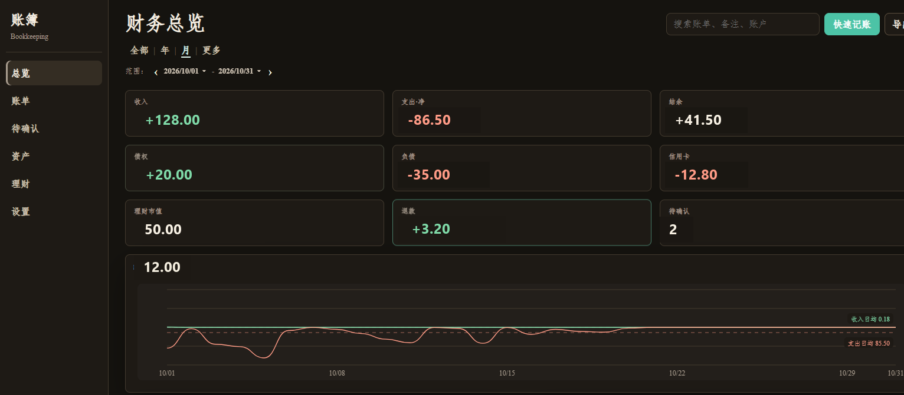

# 📒 Bookkeeping Skill · 让 AI 替你记账

<p align="center">  
    
    
    
    
  
  一个为 AI Agent 设计的<b>本地记账 Skill</b> —— 把对账、分类、去重交给 AI，数据永远留在你自己手里。  
</p>

作者 **奔跑的猪**。实现上参考了其他开源记账项目，以及鲨鱼记账等软件的产品设计。

**只需一句话**，你的 AI 助手就能帮你：

- 导入支付宝 / 微信 / 银行账单，自动清洗、去重、分类
- 记录日常收支、转账、借贷、退款、余额修正
- 打开本地 Dashboard：按分类看花在哪、按活动看这件事花了多少、按账户看关联流水

当前版本 **V1**。理财 Web 记账页尚未对用户开放，计划在 **V4** 交付。

现在常见的记账 App 卡在两头：

- **每笔都得手写** —— 支付宝付完、微信又付一笔，还要自己打开 App 再记一遍，坚持不了多久
- **能导入账单，但去不了重** —— 同一笔消费，支付宝账单里有、银行卡账单里又有；导入两次就记成两笔支出。市面软件几乎做不到「支付宝用银行卡付」和「银行扣款」是同一笔钱

就算导入成功了，它们通常还把**每一笔流水只打一个分类**。分类能回答「这个月餐饮花了多少」，回答不了另外三件事：

1. **这件事一共花了多少** —— 一次旅行、一场网球局，账单散落在餐饮、交通、住宿里
2. **退款到底算不算花出去** —— 微信 / 支付宝把退款记成入账，原支出还在，两边都虚
3. **这个账户对应哪些流水** —— 花呗欠多少、房贷还了哪些月供，点开账户看不到账单

本仓库就是为这三件事补上的。分类仍然在，活动、退款关联、资产明细是平行能力，不互相替代。

## ✨ 核心能力

| 能力                 | 说明                                         |
| ------------------ | ------------------------------------------ |
| 📥 **多源账单导入**      | 直接把支付宝、微信、银行卡导出的账单文件发给 Agent，自动识别格式、清洗、标准化 |
| 🔁 **智能去重**        | 支付宝用银行卡支付和银行卡账单其实是同一笔？跨来源去重，银行流水另做余额链校验    |
| 🧠 **自动分类与规则学习**   | 每次导入都会收集新关键词，缺失分类会询问你并记住规则                 |
| 🎯 **活动花费**        | 把多笔流水拉进同一件事（旅行、约会、球赛），看这件事净花了多少；分类统计不受影响   |
| ↩️ **退款关联**        | 退款不是收入。把它挂回原支出后，只记净花费；没花出去的钱不再算支出          |
| 🏦 **资产管家 + 关联账单** | 现金 / 卡 / 花呗 / 借款分组看净资产；点账户打开该账户全部流水        |
| 💸 **完整资金动作**      | 支出、收入、转账、借入、借出、还款、收款、退款、余额修正               |
| 📊 **财务看板**        | 本地 Dashboard：总览、账单、待确认、资产管家                |
| 🔒 **隐私优先**        | 所有数据存于本地 SQLite，开源仓库不含个人账本                 |

### 相对市面 App，V1 多出来的三件事

#### 1. 活动花费 —— 分类之外的「这件事花了多少」

分类回答的是「餐饮 / 交通各花多少」。活动回答的是「三亚旅行一共花了多少」。

- 在账单里勾选多笔流水，拉进一个活动（一笔账单只属于一个活动，避免重复计费）
- 总览直接看到该活动的**净花费、笔数、明细**
- 退款会跟着原支出自动冲减，活动金额用的是净额，不是毛额
- **不改分类饼图**：餐饮还是餐饮，活动是平行视角
- 活动可以归档封存；归档后不再往里面塞新账单

#### 2. 退款关联 —— 解决「平台把退款当收入」

微信 / 支付宝导出的账单里，退款经常变成一笔入账，原支出还在。结果是：钱已经退回来了，账上仍算花过；退款还被算成收入。

典型例子：充电扣 ¥30（含押金），后退 ¥28.40。市面软件常显示支出 30 + 收入 28.40；实际只花了 **¥1.60**。

本仓库的做法：

- 退款是独立类型，**永远不算收入**
- 把它关联到原来那笔支出：支出显示「已退 28.40 · 净 1.60」
- 没关联上的退款不进收支，只在退款卡里标「待关联」
- 跨月退款也冲回原支出的日期和分类，这个月的餐饮数字不会被下个月的退款搅乱
- 高置信的退款会自动挂上，对不上的留给你在 Dashboard 点一下

#### 3. 资产管家 —— 账户能点开看关联账单

市面软件常见「账户只有一个余额数字」。这里每个账户都能打开**关联流水**：

- 资产页按现金、虚拟账户、储蓄卡、信用卡、负债、债权分组，顶部是净资产
- 点花呗 / 房贷 / 某张卡的「明细」，跳到该账户全部账单，对得上余额
- 信用卡型（花呗、白条）：消费时记支出，还款只还欠款、不再记一次支出
- 借款 / 贷款：本金、还款、利息分开看，避免同一笔钱记两次支出

## 🧰 快速开始

### 前提

- 已有 AI Agent（如 Claude Code、Codex、WorkBuddy）
- Python 3.8+
- 依赖 `openpyxl`（导入支付宝 / 微信 Excel 账单时需要）

### 1. 安装 Skill

**一句话安装（推荐）**

复制这句话发给 Agent：

```shell
帮我安装这个 skill：https://github.com/chenxueliang3-star/bookkeeping-skill.git，仅保留 SKILL.md、scripts/ 和 tests/
```

### 2. 首次导入历史账单

把账单文件路径发给 Agent，它会自动完成清洗、去重、写入本地账本。

```shell
记账：'/Users/xxx/Documents/支付宝账单流水文件.xlsx'
```

> 建议先导入完整历史账单（例如过去 1 年），然后在 Dashboard 里把各账户余额校准到当天真实值。之后新增的账单，系统会基于收支、转账更新余额。

预置分类规则无法满足你？在 `scripts/config.yaml` 中修改。**不要把含真实卡号、小荷包名的个人配置提交进公开仓库。**

### 3. 启动 Dashboard

```shell
python scripts/bookkeeping.py dashboard
```

默认端口 **8765**。浏览器打开提示的本地地址即可。

### 4. 运行测试

```shell
cd skill
python -m unittest discover -s tests -v
```

测试在临时目录建一个空库，不读取真实账本。数据是虚构的账户和商户。

## 📦 如何获取账单文件？

### 支付宝

> 支付宝 → 我的 → 账单 → 右上角三个点 → 开具交易流水证明 → 用于个人对账

### 微信

> 微信 → 我 → 服务 → 钱包 → 账单 → 右上角三个点 → 下载账单 → 用作个人对账

### 其他银行

各家银行 APP 即可导出，Skill 会在导入前自动校验并提示缺少的字段。

## 📸 Dashboard

本地 Web 看板覆盖总览、账单、待确认和资产管家。



> 截图里的金额是改过的测试数字，不是真实账本。

- 总览：收支、退款卡、待确认、**活动花费**（每张活动卡是这件事的净花费）
- 账单：分类筛选 + 勾选流水拉进活动；退款与原支出成对显示
- 资产：分组账户，点明细查看该账户关联账单
- V1 关闭理财页入口（V4 再开放）；总览「理财市值」点击后跳到资产页投资组

## 🗺 后续计划

- 现在：**V1** — 本地记账 Skill + Dashboard（理财页入口关闭）。流水增删查改、退款关联、活动挂载/归档、资产账户增改已走 CLI，说明见 `SKILL.md`
- 大版本 **V2**：Harness 插件 —— 把现有 CLI 做成可被其他 AI 宿主直接安装调用的插件形态
- 大版本 **V3**：更新 UI
- 大版本 **V4**：添加理财记账功能

## 🚀 为什么需要它？

市面记账 App 的缺点很具体：要么每笔手写，累；要么能从微信 / 支付宝 / 银行导入，却把同一笔钱记两次——支付宝账单和银行卡账单对不上。即便导入顺了，也大多停在「一笔流水一个分类」：退款会被算成收入，旅行花了多少只能自己加，账户也只给一个余额。数据还容易上云。

做这个 Skill，是为了把清洗、**跨来源去重**交给 Agent，不用再手抄账单，也不会因为多导一份流水就虚增支出。同时补上活动花费、退款关联、账户关联账单这三块市面软件缺的能力。账本继续躺在自己电脑上的 SQLite 里。

实现上参考了其他开源记账项目，以及鲨鱼记账等软件（账户分组、明细对账、信用卡/借款口径）。在此之上把分类、活动、退款、资产做成能对上账的一套口径。

如果觉得有用，欢迎点个 ⭐️。

## 🔒 隐私

- 账目数据只存在本机 SQLite，默认不在 skill 目录内
- 开源仓库不含个人账本（`*.db` 已加入 `.gitignore`）
- `scripts/config.yaml` 在开源副本里只保留通用示例账户

## 📬 联系作者

作者 **奔跑的猪**。有问题、建议或想一起改这个 Skill，欢迎联系：

- 邮箱：<CXL15602604253@163.com>
- 微信：扫描下方二维码添加

<p align="center">  
    
</p>
